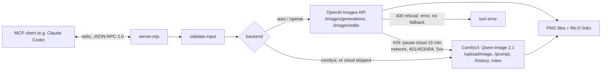

# mcp-image-gen

A small Node.js [MCP](https://modelcontextprotocol.io) server that gives an AI coding agent (Claude Code or any MCP client) one tool, `generate_image`. It uses the OpenAI Images API when configured, and falls back automatically to **Qwen-Image 2.1 running on a local ComfyUI server** when the cloud is rate-limited or unavailable, so image work does not stop when a quota runs out.

No npm dependencies: Node.js built-ins only (`fetch`, `FormData`, `node:test`).


*Sample output of the local route, requested over MCP stdio with the prompt "a small red fox sitting in a snowy forest, soft morning light" (Qwen-Image 2.1 on ComfyUI, 1024x1024, 35 s).*

## Architecture



## Quickstart

Requirements: Node.js 20.11+; for the local backend, a ComfyUI server with the Qwen-Image 2.1 nodes (`TextEncodeQwenImage21`, `QwenImage21Cache`) and the model files; for the cloud backend, an OpenAI API key.

```bash
git clone <this repo> && cd mcp-image-gen
npm test

# register with Claude Code (the key is read from your environment, not stored in the MCP config)
export OPENAI_API_KEY=...            # optional
claude mcp add image-gen -e COMFYUI_URL=http://127.0.0.1:8188 -- node /path/to/mcp-image-gen/src/server.mjs
```

All settings are environment variables; see [.env.example](.env.example). The main ones:

| Variable | Default | Meaning |
|---|---|---|
| `OPENAI_API_KEY` | (none) | Enables the cloud backend. Without it, `auto` goes straight to ComfyUI. |
| `OPENAI_IMAGE_MODEL` | `gpt-image-1` | Model sent to the Images API. OpenAI's guide now lists newer GPT Image models; set this to a current one. |
| `COMFYUI_URL` | `http://127.0.0.1:8188` | The ComfyUI server. |
| `QWEN_UNET`, `QWEN_CLIP`, `QWEN_VAE` | the Qwen-Image 2.1 file names | Model files in your ComfyUI install. |
| `IMAGE_OUTPUT_DIR` | `~/Pictures/mcp-image-gen` | Where images go when the call names no path. |

### The tool

`generate_image { prompt, output?, references?, format?, quality?, variants?, backend? }`

- `references`: up to 10 image paths (PNG/JPEG/WebP, max 20 MB each) to keep a character, place or style. OpenAI receives them as `image[]` parts of `/images/edits`; ComfyUI receives them as uploads wired into the Qwen-Image 2.1 encoder.
- `format`: `portrait` (default; 1024x1536 on OpenAI, 768x1376 on ComfyUI), `square`, `landscape`.
- `backend`: `auto` (default), `openai` or `comfyui`.
- The result names the backend, the real pixel size read from the PNG header, the time, the saved paths and a `file:///` link for each, plus a note when it fell back.

## Tests and CI

```bash
npm test     # node --test: 23 tests, offline
```

Every HTTP call goes to local fake servers started by the tests (a fake OpenAI and a fake ComfyUI built on `node:http`); there are no real API calls. `test/server.test.mjs` runs the real server process over stdio end to end. `.github/workflows/ci.yml` runs the suite on Ubuntu and Windows with Node 20 and 22.

## Security

- **Transport: stdio only.** The server opens no network port; it talks only to the MCP client that started it, and makes outbound requests only to the configured OpenAI and ComfyUI URLs.
- **Inputs validated** before any request: prompt required and at most 4,000 characters; enums for `format`, `quality` and `backend`; `variants` an integer from 1 to 4; at most 10 references, each an existing regular file with an image extension and at most 20 MB; `output` a non-empty path without NUL bytes. Unknown arguments are rejected by the schema (`additionalProperties: false`).
- **No secrets logged.** The server logs nothing; stdout carries only protocol messages. The API key is read from the environment, sent only in the `Authorization` header, and redacted from any upstream error text before it reaches the client (some APIs echo the key back in auth errors; a test checks this).
- **No silent routing around refusals.** A cloud refusal (HTTP 400, e.g. a content policy rejection) is returned as an error; it is not retried on the local model unless the caller explicitly asks for `backend: "comfyui"`.
- The server writes images wherever the client asks (`output`): it trusts its MCP client, like any local tool with file access.

## Design decisions

- **Classify cloud errors, then decide.** `rate-limited` (429, quota) -> fall back and skip the cloud for 15 minutes, so the next calls do not wait on a known failure; `unavailable` (network, 401/403/404, 5xx) -> fall back for this call; `refused` -> error.
- **The local workflow is built in code.** The ComfyUI graph (API format) is generated by `buildWorkflow`, so references are padded to the encoder's three inputs (repeating the last), extra references get their own nodes, and an explicit `EmptyLatentImage` fixes the canvas size (otherwise the canvas follows the first reference). One job per variant, consecutive seeds.
- **Real size in the result.** The reported size is read from the saved PNG header, not from the request.
- **The tool stays visible.** `_meta["anthropic/alwaysLoad"]` keeps it in the model's base tool list, so the model calls it instead of answering "I created the image" without calling anything.
- **Zero dependencies**, so the server starts instantly and has no supply-chain surface beyond Node.js.

## Limitations

- **The OpenAI request/response shape is unverified against the live API** in this version (see below); the default model name may need changing for your account.
- The ComfyUI backend needs the Qwen-Image 2.1 nodes and models; other models need another workflow. It polls `/history` every 2 seconds instead of using the WebSocket API.
- No streaming or partial images; no cancellation of a running ComfyUI job when the client disconnects.
- Variants on ComfyUI run one after another.

## How this was built

Built with AI coding agents (Claude Code), which wrote most of the code. The author owned the architecture (backend order, error classes and when to fall back, the security rules), the review gates and the verification.

What was verified, and how:

- **This repository:** 23 offline tests pass with `npm test` (fake OpenAI and ComfyUI servers; the stdio server tested as a real child process). Each critical rule was checked by injecting a deliberate bug and confirming a test fails: no fallback on refusal, key redaction, the rate-limit pause, reference padding, consecutive seeds, and the 401 classification.
- **The private predecessor** of this server (same tool, same fallback rules, a different cloud route) was verified with a stdio test harness, no model involved: real cloud text-to-image and reference-guided generations, a real local Qwen-Image 2.1 generation (21 s), and a fake cloud endpoint answering 429, after which the server switched to Qwen and the next request skipped the cloud. A real Claude Code session then found the tool on its own and returned the `file:///` link; that is also how the `alwaysLoad` flag was found to be necessary. The ComfyUI workflow graph (nodes, parameters, the `EmptyLatentImage` canvas fix, padding references to three) comes from the author's production setup.
- **Local route, verified on a real server (29.10.2026):** this server, started as a stdio child process with no OpenAI key, answered `initialize`, `tools/list` and a `generate_image` call; `auto` fell back to ComfyUI with the note "OpenAI not configured" and Qwen-Image 2.1 returned a 1024x1024 PNG in 35 s (the sample above).
- **Cloud route, not run yet:** the predecessor's cloud route was replaced here by the official OpenAI Images API, which has not been called with a real OpenAI account; it is covered by the mocked tests only. The request shape was checked against OpenAI's image-generation guide on 29.10.2026 (repeated `image[]` parts, the three sizes, `data[].b64_json`). Assumptions about the OpenAI API: `POST /v1/images/generations` (JSON) and `POST /v1/images/edits` (multipart, repeated `image[]` parts), fields `model`, `prompt`, `n`, `size` (`1024x1536`, `1024x1024`, `1536x1024`), optional `quality` (`low`/`medium`/`high`), response `data[].b64_json`, errors as `{ error: { message, code } }`, default model `gpt-image-1`.
- **CI:** GitHub Actions runs `npm test` on Ubuntu and Windows with Node 20 and 22; the first run passed on 29.10.2026.

## License

MIT, see [LICENSE](LICENSE).
