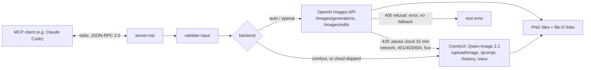

# mcp-image-gen

This is a small Node.js [MCP](https://modelcontextprotocol.io) server that gives an AI coding agent (Claude Code or any MCP client) one tool, `generate_image`.

I generate a lot of images from Claude Code sessions, and I run ComfyUI with Qwen-Image 2.1 on my own GPU. Cloud image quotas run out, and when the one I relied on did, my image work stopped. So this server tries the OpenAI Images API first (when it's configured) and falls back automatically to **Qwen-Image 2.1 on a local ComfyUI server** when the cloud is rate-limited or unavailable.

No npm dependencies, just Node.js built-ins (`fetch`, `FormData`, `node:test`).


*Sample output of the local route, requested over MCP stdio with the prompt "a small red fox sitting in a snowy forest, soft morning light" (Qwen-Image 2.1 on ComfyUI, 1024x1024, 35 s).*

## How it works



## Quickstart

You need Node.js 20.11+. The local backend also needs a ComfyUI server with the Qwen-Image 2.1 nodes (`TextEncodeQwenImage21`, `QwenImage21Cache`) and the model files; the cloud backend needs an OpenAI API key.

```bash
git clone <this repo> && cd mcp-image-gen
npm test

# register with Claude Code (the key is read from your environment, not stored in the MCP config)
export OPENAI_API_KEY=...            # optional
claude mcp add image-gen -e COMFYUI_URL=http://127.0.0.1:8188 -- node /path/to/mcp-image-gen/src/server.mjs
```

Everything is configured through environment variables (see [.env.example](.env.example)). These are the main ones:

| Variable | Default | Meaning |
|---|---|---|
| `OPENAI_API_KEY` | (none) | Turns on the cloud backend. Without it, `auto` goes straight to ComfyUI. |
| `OPENAI_IMAGE_MODEL` | `gpt-image-1` | The model sent to the Images API. OpenAI's guide now lists newer GPT Image models, so set this to a current one. |
| `COMFYUI_URL` | `http://127.0.0.1:8188` | The ComfyUI server. |
| `QWEN_UNET`, `QWEN_CLIP`, `QWEN_VAE` | the Qwen-Image 2.1 file names | Model files in your ComfyUI install. |
| `IMAGE_OUTPUT_DIR` | `~/Pictures/mcp-image-gen` | Where images go when the call doesn't name a path. |

### The tool

`generate_image { prompt, output?, references?, format?, quality?, variants?, backend? }`

- `references`: up to 10 image paths (PNG/JPEG/WebP, max 20 MB each) to keep a character, place or style. OpenAI gets them as `image[]` parts of `/images/edits`; ComfyUI gets them as uploads wired into the Qwen-Image 2.1 encoder.
- `format`: `portrait` (default; 1024x1536 on OpenAI, 768x1376 on ComfyUI), `square`, `landscape`.
- `backend`: `auto` (default), `openai` or `comfyui`.
- The result names the backend, the real pixel size read from the PNG header, the time, and the saved paths with a `file:///` link for each, plus a note when it fell back.

## Tests and CI

```bash
npm test     # node --test: 23 tests, offline
```

The tests start local fake servers (a fake OpenAI and a fake ComfyUI, built on `node:http`), and every HTTP call goes to them, so there are no real API calls. `test/server.test.mjs` runs the real server process over stdio, end to end. `.github/workflows/ci.yml` runs the suite on Ubuntu and Windows with Node 20 and 22.

## Security

These are the security rules I set for the server:

- Transport is stdio only. The server opens no network port, talks only to the MCP client that started it, and makes outbound requests only to the configured OpenAI and ComfyUI URLs.
- Inputs are validated before any request goes out: the prompt is required and at most 4,000 characters; `format`, `quality` and `backend` are enums; `variants` is an integer from 1 to 4; there are at most 10 references, each an existing regular file with an image extension and at most 20 MB; `output` must be a non-empty path without NUL bytes. The schema rejects unknown arguments (`additionalProperties: false`).
- No secrets are logged, because nothing is logged: stdout carries only protocol messages. The API key is read from the environment, sent only in the `Authorization` header, and redacted from any upstream error text before it reaches the client (some APIs echo the key back in auth errors; a test checks the redaction).
- Refusals are never routed around silently. A cloud refusal (HTTP 400, e.g. a content policy rejection) comes back as an error. It isn't retried on the local model unless the caller explicitly asks for `backend: "comfyui"`.
- The server writes images wherever the client asks (`output`). It trusts its MCP client, like any local tool with file access.

## Design decisions

- **Classify cloud errors, then decide.** `rate-limited` (429, quota) -> fall back and skip the cloud for 15 minutes, so the next calls don't wait on a known failure; `unavailable` (network, 401/403/404, 5xx) -> fall back for this call; `refused` -> error.
- **The local workflow is built in code.** `buildWorkflow` generates the ComfyUI graph (API format). That way references are padded to the encoder's three inputs (repeating the last one), extra references get their own nodes, and an explicit `EmptyLatentImage` fixes the canvas size (without it, the canvas follows the first reference). One job per variant, with consecutive seeds.
- **Real size in the result.** The reported size is read from the saved PNG header, not from the request.
- **The tool stays visible.** `_meta["anthropic/alwaysLoad"]` keeps it in the model's base tool list, so the model calls it instead of answering "I created the image" without calling anything.
- **Zero dependencies**, so the server starts instantly and has no supply-chain surface beyond Node.js.

## Limitations

- **I haven't verified the OpenAI request/response shape against the live API** in this version (see below), and the default model name may need changing for your account.
- The ComfyUI backend needs the Qwen-Image 2.1 nodes and models; other models need another workflow. It polls `/history` every 2 seconds instead of using the WebSocket API.
- No streaming or partial images, and no cancellation of a running ComfyUI job when the client disconnects.
- Variants on ComfyUI run one after another.

## How I built it

I built this with AI coding agents (Claude Code), which wrote most of the code. My part was the architecture (the backend order, the error classes and when to fall back, the security rules), the review gates and the verification.

I don't take an agent's "done" at face value, so this is what I checked, and how:

- This repository: `npm test` runs 23 offline tests and they pass (fake OpenAI and ComfyUI servers; the stdio server is tested as a real child process). I also checked each critical rule by injecting a deliberate bug and confirming that a test fails: no fallback on refusal, key redaction, the rate-limit pause, reference padding, consecutive seeds, and the 401 classification.
- The private predecessor of this server is the version I use every day (same tool, same fallback rules, a different cloud route). I verified it with a stdio test client, no model involved: real cloud text-to-image and reference-guided generations, a real local Qwen-Image 2.1 generation (21 s), and a fake cloud endpoint answering 429, after which the server switched to Qwen and the next request skipped the cloud. Then a real Claude Code session found the tool on its own and returned the `file:///` link. That's also how I found out the `alwaysLoad` flag was necessary. The ComfyUI workflow graph (nodes, parameters, the `EmptyLatentImage` canvas fix, padding references to three) comes from my production setup.
- Local route, verified on a real server (29.10.2026): I started this server as a stdio child process with no OpenAI key, and it answered `initialize`, `tools/list` and a `generate_image` call. With `auto`, it fell back to ComfyUI with the note "OpenAI not configured", and Qwen-Image 2.1 returned a 1024x1024 PNG in 35 s (the sample above).
- **Cloud route, not run yet:** in this repo the predecessor's cloud route is replaced by the official OpenAI Images API, which has never been called with a real OpenAI account. Only the mocked tests cover it. I checked the request shape against OpenAI's image-generation guide on 29.10.2026 (repeated `image[]` parts, the three sizes, `data[].b64_json`). My assumptions about the OpenAI API: `POST /v1/images/generations` (JSON) and `POST /v1/images/edits` (multipart, repeated `image[]` parts), fields `model`, `prompt`, `n`, `size` (`1024x1536`, `1024x1024`, `1536x1024`), optional `quality` (`low`/`medium`/`high`), response `data[].b64_json`, errors as `{ error: { message, code } }`, default model `gpt-image-1`.
- CI: GitHub Actions runs `npm test` on Ubuntu and Windows with Node 20 and 22. The first run passed on 29.10.2026.

## License

MIT, see [LICENSE](LICENSE).
